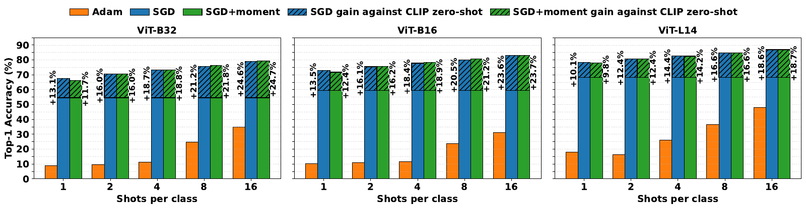

# Full Fine-Tuning is not the Problem
## Why Adam Fails and SGD Succeeds in Few-Shot CLIP Adaptation

**Nairouz Mrabah · Ismail Ben Ayed · Éric Granger**  
École de technologie supérieure, Montréal  
**NeurIPS 2026**

[Reproduction guide](docs/REPRODUCING.md) · [Dataset preparation](docs/DATASETS.md) · [Diagnostic experiments](docs/EXPERIMENTS.md) · [Supplementary tables](Rebuttal/README.md) · [Citation](#citation)

This repository provides the code for our study of optimizer behavior in few-shot CLIP adaptation. Across **11 datasets**, **three CLIP backbones**, and **five shot levels**, SGD supports effective dense adaptation and outperforms the representative PEFT methods evaluated in the paper under the common training protocol.



*Figure from the paper. Average test accuracy across 11 datasets. Detailed settings and uncertainty are reported in the manuscript.*

## Main findings

- **Optimization determines the outcome of dense adaptation.** SGD performs well under the same few-shot setting in which Adam and AdamW can collapse.
- **Few-shot preconditioning explains the failure mechanism.** Inaccurate second-moment estimates produce oversized adaptive updates, with miscalibration already present at initialization.
- **First-step budget matching provides a direct intervention.** Matching Adam's initial update norm to SGD resolves most of the observed collapse.
- **SGD preserves useful pretrained structure.** Its trajectories remain close to initialization and follow broad, connected regions of low loss and curvature.

The release includes full fine-tuning baselines, 13 PEFT methods, zero-shot evaluation, and 20 diagnostic experiment packages. The main benchmark trains dense attention and MLP weight matrices in both CLIP encoders. Exact trainable scope and execution details are documented in the [reproduction guide](docs/REPRODUCING.md).

## Installation

A Python environment with a compatible **PyTorch / torchvision** pair and a CUDA GPU supports the training entry points. The supplied code uses `torch.autocast` and `torch.GradScaler`.

```bash
python -m venv .venv
source .venv/bin/activate
python -m pip install -r requirements.txt
```

The requirements list reflects imports in the supplied code. An original version-locked environment was not included. The CLIP implementation and tokenizer vocabulary are bundled; pretrained model weights are downloaded by the CLIP loader on first use. Dataset images and split files are prepared separately, as described in [DATASETS.md](docs/DATASETS.md).

## A first experiment

The following command runs dense SGD adaptation on 16-shot DTD with CLIP ViT-B/16. Each run uses a separate output directory to keep learning-rate trials distinct.

```bash
python scripts/run_experiment.py \
  --method SGD \
  --output-dir results/dtd/sgd/vit-b16/16shot/seed1/lr1e-4 \
  --root_path /absolute/path/to/datasets \
  --dataset dtd --backbone ViT-B/16 \
  --shots 16 --seed 1 --lr 1e-4 \
  --max_epochs 30 --batch_size 64 \
  --encoder both --position all --use_aug
```

The launcher forwards experiment arguments to the supplied implementation. `--dry-run` displays the command without importing PyTorch, downloading weights, or starting training. Adam uses `--method Adam`; LoRA uses `--method LoRA --optimizer Adam --rank 2`.

## Repository contents

| Directory | Contents |
| --- | --- |
| `FT/` | SGD, Adam, three AdamW weight-decay settings, Shampoo, and SOAP |
| `PEFT/` | Adapter, BitFit, CoOp, GaLoRE, KgCoOp, LayerNorm, LoRA, LP++, PiSSA, ProGrad, SAFT, SO, and TIP-Adapter |
| `ZS/` | Zero-shot CLIP evaluation |
| `Investigation/Adam_investigation/` | Second-moment calibration, counterfactual denominators, budget matching, and representation drift |
| `Investigation/SGD_investigation/` | Interpolation, directional curvature, block sensitivity, connectivity, drift, and stochasticity controls |
| `Rebuttal/` | Camera-ready numerical exports and reproducible table calculations |
| `scripts/` | Portable experiment launcher and source validation |
| `docs/` | Protocol, dataset, experiment, and release documentation |

## Experimental protocol

| Component | Main benchmark |
| --- | --- |
| Backbones | CLIP ViT-B/16, ViT-B/32, ViT-L/14 |
| Shots per class | 1, 2, 4, 8, 16 |
| Seeds | 1, 2, 3 |
| Training | 30 epochs; batch size 64 |
| Main learning rate | 0.0001 |
| Robustness grid | 0.01, 0.001, 0.0001, 0.00001 |
| Datasets | ImageNet, SUN397, FGVC-Aircraft, EuroSAT, StanfordCars, Food101, OxfordPets, OxfordFlowers, Caltech101, DTD, UCF101 |

The paper also reports longer trajectories and diagnostic interventions. Those experiments have separate configurations; the [experiment index](docs/EXPERIMENTS.md) maps them to their source files.

## Citation

```bibtex
@inproceedings{mrabah2026full,
  title     = {Full Fine-Tuning is not the Problem: Why Adam Fails and SGD Succeeds in Few-Shot CLIP Adaptation},
  author    = {Mrabah, Nairouz and Ben Ayed, Ismail and Granger, {\'E}ric},
  booktitle = {Advances in Neural Information Processing Systems},
  year      = {2026}
}
```

## Acknowledgments

The experiments used computing resources provided by the Digital Research Alliance of Canada. N. Mrabah acknowledges a B3 postdoctoral fellowship from the Fonds de recherche du Québec (FRQ), Nature et technologies (award 2011136; [doi:10.69777/2011136](https://doi.org/10.69777/2011136)).

Third-party code retains its attribution and applicable terms. [THIRD_PARTY_NOTICES.md](THIRD_PARTY_NOTICES.md) records the included notices and source references.
